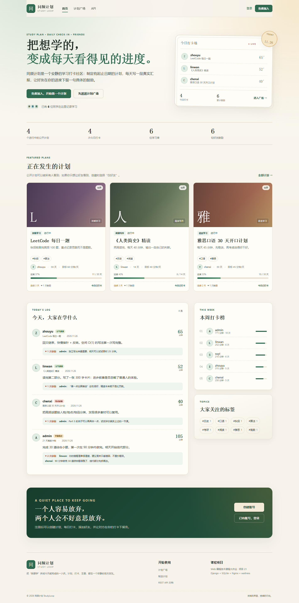
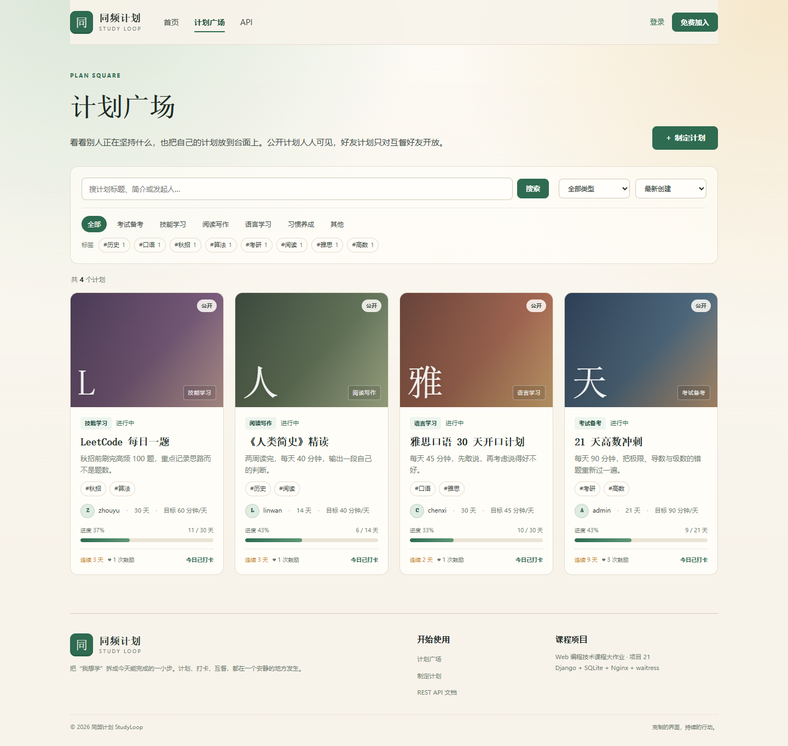
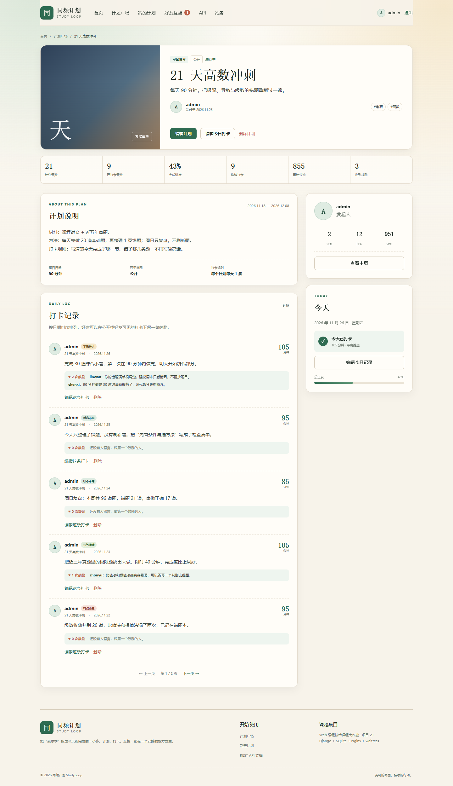
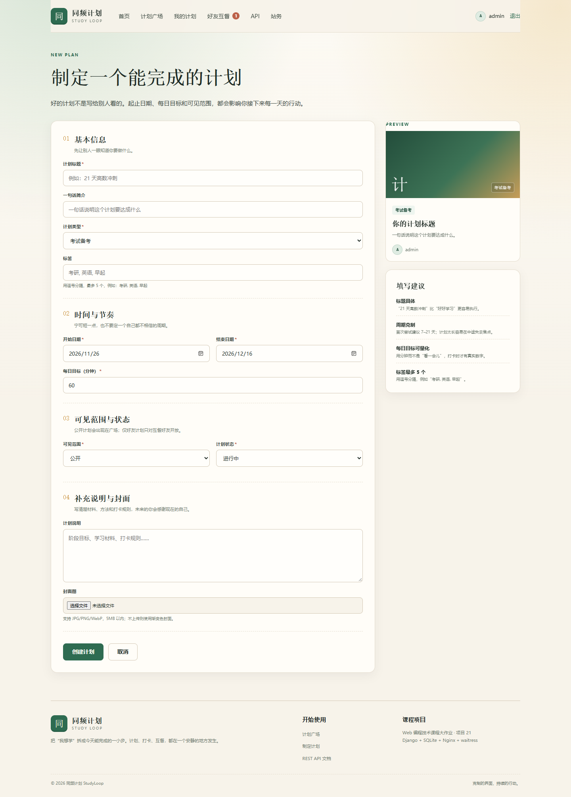
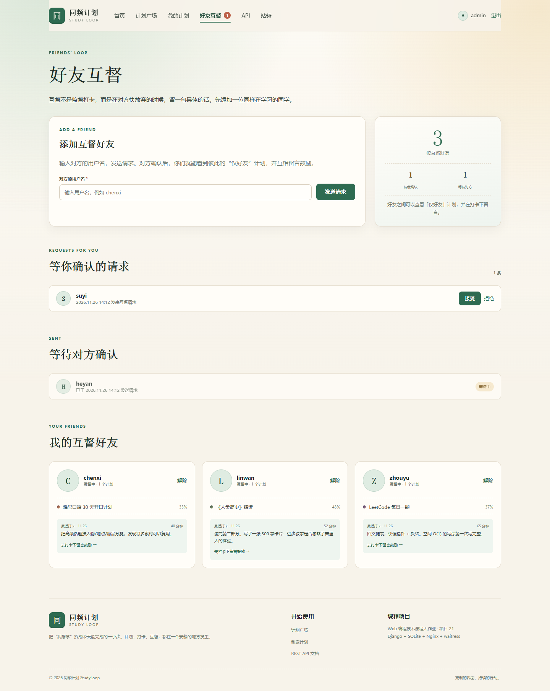
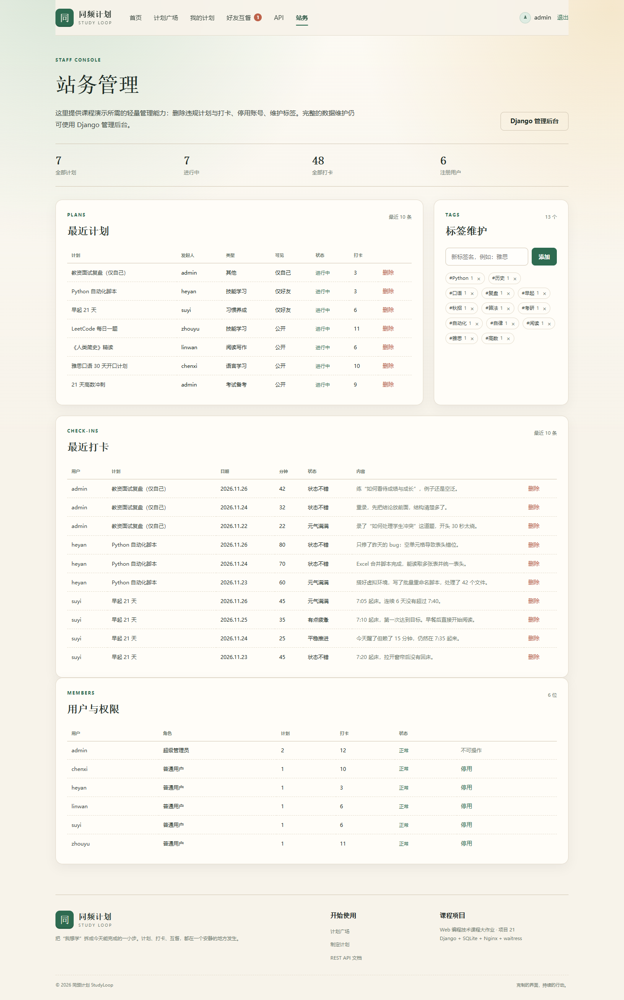
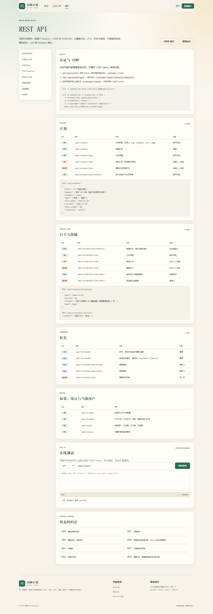

# 同频计划 StudyLoop

《Web 编程技术》课程大作业 **项目 21：学习计划打卡社区**。
一个克制、可持续的学习打卡社区：制定有起止日期的计划，每天写一段真实汇报，让互督好友在打卡下留一句具体的鼓励。

- 题目关键词：计划制定、每日汇报、好友互督
- 技术栈：Python 3.12+ / Django 6.x / SQLite / Django 模板 + 原生 HTML、CSS、JavaScript
- 部署：Nginx + waitress，独立端口，不与已有博客和旧项目冲突
- 演示站点（本地）：默认 `http://127.0.0.1:8000/`；本机验收使用 `http://127.0.0.1:8021/`



## 一、功能清单

### 账号与角色
- 注册、登录、退出；注册时校验用户名格式与密码强度。
- 两种角色：普通用户、站务成员（`is_staff`）。
- 站务成员拥有独立站务页 `/manage/`，并可进入 Django 原生后台 `/admin/`。

### 计划
- 创建、编辑、删除学习计划。
- 字段：标题、简介、说明、类型、标签、封面图、起止日期、每日目标分钟、可见范围、状态。
- 三种可见范围：公开、仅好友、仅自己。
- 状态：进行中、已完成、已放弃。
- 计划卡片展示进度、连续天数、累计分钟、鼓励数、今日打卡状态。
- 计划广场支持关键词、类型、标签筛选，以及最新 / 打卡最多 / 鼓励最多 / 即将结束排序。

### 每日打卡
- 仅计划发起人可以打卡。
- 每个计划每天最多一条打卡，数据库唯一约束 + 表单/接口双重校验。
- 记录日期、投入分钟、今日状态、文字汇报、学习留影（图片上传）。
- 打卡时间必须落在计划起止日期内，且不能打未来的卡。
- 支持编辑、删除自己的打卡。
- 自动统计打卡天数、进度百分比、连续天数、累计分钟。

### 好友互督
- 按用户名搜索并发送好友请求。
- 接收、拒绝、解除互督关系。
- 好友可以看到彼此的「仅好友」计划。
- 好友可以在公开 / 好友可见的打卡下留言鼓励；每条打卡每人只能留一次，可取消。
- 不能给自己留言；非好友不能留言。

### REST API
- 统一的 `/api/v1/` JSON API，覆盖计划、打卡、好友、鼓励、标签、统计。
- Session + CSRF 认证；写操作要求登录并携带 `X-CSRFToken`。
- 分页、错误码、字段校验、权限判断完整。
- `/api-docs/` 提供可读文档和在线调试面板。

## 二、快速开始

要求 Python 3.12 及以上。

```bash
cd study-plan-community

python -m venv .venv
# Windows
.venv\Scripts\activate
# Linux / macOS
source .venv/bin/activate

pip install -r requirements.txt
python manage.py migrate
python manage.py seed_demo
python manage.py runserver
```

打开 `http://127.0.0.1:8000/`；如果端口被占用，可改用 `python manage.py runserver 127.0.0.1:8021`，然后访问 `http://127.0.0.1:8021/`。

### 演示账号

| 账号 | 密码 | 角色 | 说明 |
| --- | --- | --- | --- |
| `admin` | `admin123` | 超级管理员 / 站务 | 可体验全部功能与后台 |
| `chenxi` | `demo12345` | 普通用户 | 雅思口语计划发起人 |
| `linwan` | `demo12345` | 普通用户 | 精读计划发起人 |
| `zhouyu` | `demo12345` | 普通用户 | LeetCode 计划发起人 |
| `suyi` | `demo12345` | 普通用户 | 早起计划发起人，有待确认好友请求 |
| `heyan` | `demo12345` | 普通用户 | Python 自动化计划发起人 |

重新生成演示数据（会清空计划、打卡、好友、鼓励、标签，不删除用户）：

```bash
python manage.py seed_demo --reset
```

## 三、页面与路由（12 个模板页）

| # | 页面 | 路由 | 说明 |
| --- | --- | --- | --- |
| 1 | 首页 | `/` | 社区数据、精选计划、今日打卡、排行榜、好友动态 |
| 2 | 计划广场 | `/plans/` | 搜索、筛选、排序、分页 |
| 3 | 计划详情 | `/plans/<id>/` | 计划说明、进度、打卡时间线、互督操作 |
| 4 | 创建计划 | `/plans/new/` | 计划表单与实时预览 |
| 5 | 编辑计划 | `/plans/<id>/edit/` | 发起人 / 站务；复用 `plan_form.html` |
| 6 | 我的计划 | `/my/plans/` | 状态筛选、统计、快捷打卡 |
| 7 | 打卡表单 | `/plans/<id>/checkin/` | 新增或跳转编辑今日打卡 |
| 8 | 好友互督 | `/friends/` | 添加好友、待确认请求、好友动态 |
| 9 | 个人主页 | `/u/<username>/` | 用户统计、公开计划、互督入口 |
| 10 | 登录 | `/accounts/login/` | Session 登录 |
| 11 | 注册 | `/accounts/register/` | 注册并进入创建计划 |
| 12 | 站务管理 | `/manage/` | 计划 / 打卡 / 用户 / 标签维护 |
| — | API 文档 | `/api-docs/` | 端点什么、认证说明、在线调试 |

编辑页与创建页共用 `plan_form.html`，因此页面模板共 12 个；API 文档作为开发者页面额外提供。另有 `base.html`、`403.html`、`404.html` 和若干可复用局部模板。

## 四、数据模型

共 5 个模型，满足 3–5 个模型、一对多和多对多要求。

| 模型 | 关键字段 | 关系 |
| --- | --- | --- |
| `Tag` | `name` | 与 `Plan` 多对多 |
| `Plan` | `owner`、标题、说明、起止日期、每日目标、可见范围、状态、封面 | `owner` → `User` 一对多；`tags` 多对多 |
| `CheckIn` | `plan`、`user`、日期、分钟、汇报、状态、留影 | `plan` / `user` 一对多；`plan + date` 唯一 |
| `Friendship` | `requester`、`addressee`、状态 | 两个 User 外键；方向唯一 |
| `Cheer` | `checkin`、`from_user`、内容 | `checkin` / `from_user` 一对多；`checkin + from_user` 唯一 |

关键规则：
- `Plan.visible_to(user)` 统一处理公开 / 好友 / 私有 / 站务可见性。
- `Plan.duration_days`、`checked_days`、`progress_percent`、`current_streak` 等为模型属性，模板和 API 共用。
- `CheckIn.clean()` 校验未来日期、计划边界、打卡人身份、分钟范围。
- `CheckIn.save()` 调用 `full_clean()`，表单之外也守住业务规则。

## 五、REST API 摘要

完整说明见 `/api-docs/`，机器可读索引见 `/api/v1/docs/`。

```text
GET    /api/v1/csrf/
POST   /api/v1/auth/login/
POST   /api/v1/auth/logout/
GET    /api/v1/me/

GET    /api/v1/plans/                  ?q=&tag=&category=&sort=&page=
POST   /api/v1/plans/
GET    /api/v1/plans/{id}/
PUT    /api/v1/plans/{id}/
DELETE /api/v1/plans/{id}/
GET    /api/v1/plans/{id}/checkins/
POST   /api/v1/plans/{id}/checkins/

GET    /api/v1/checkins/{id}/
PUT    /api/v1/checkins/{id}/
DELETE /api/v1/checkins/{id}/
POST   /api/v1/checkins/{id}/cheer/
DELETE /api/v1/checkins/{id}/cheer/

GET    /api/v1/friends/
POST   /api/v1/friends/
POST   /api/v1/friends/{id}/accept/
POST   /api/v1/friends/{id}/reject/
DELETE /api/v1/friends/{id}/

GET    /api/v1/tags/
GET    /api/v1/stats/
```

示例：登录并创建计划。

```bash
# 1. 获取 CSRF Token 和 Cookie
curl -c cookies.txt http://127.0.0.1:8000/api/v1/csrf/

# 2. 登录
curl -b cookies.txt -c cookies.txt -X POST \
  -H "Content-Type: application/json" \
  -H "X-CSRFToken: <上一步返回的 token>" \
  -d '{"username":"admin","password":"admin123"}' \
  http://127.0.0.1:8000/api/v1/auth/login/

# 3. 创建计划
curl -b cookies.txt -X POST \
  -H "Content-Type: application/json" \
  -H "X-CSRFToken: <token>" \
  -d '{
    "title": "7 天早起计划",
    "summary": "把起床时间稳定在 7:10",
    "category": "habit",
    "tags": ["早起", "自律"],
    "start_date": "2026-11-26",
    "end_date": "2026-12-02",
    "daily_target": 30,
    "visibility": "public"
  }' \
  http://127.0.0.1:8000/api/v1/plans/
```

错误码约定：
- `400` 参数校验失败，`details` 给出字段原因
- `401` 未登录
- `403` 已登录但无权限
- `404` 资源不存在
- `409` 重复打卡、重复鼓励、好友关系冲突

## 六、权限与边界情况

- 未登录：只能看公开计划与公开打卡；访问私有计划返回 403。
- 普通用户：可管理自己的计划与打卡；不能编辑别人的计划；不能给别人的计划打卡。
- 好友：可查看「仅好友」计划；可在对方可见的打卡下留言。
- 站务：可查看全部计划，可编辑 / 删除计划与打卡，可停用普通账号，不能停用自己或超级管理员。
- 边界：
  - 结束日期早于开始日期 → 表单 / 模型 / API 均拒绝。
  - 计划最长 365 天；每日目标 1–720 分钟。
  - 打卡日期必须在计划周期内且不能是未来。
  - 同一计划同一天重复打卡 → 页面跳转编辑，API 返回 409。
  - 重复鼓励、给自己鼓励、非好友鼓励 → 拒绝。
  - 上传图片限制 5MB；未上传封面时使用渐变色封面。
  - 404 / 403 使用统一错误页。

## 七、测试

```bash
python manage.py test community -v 1
```

当前共 **28 个测试**，覆盖：
- 模型统计、可见性、日期校验、唯一约束、打卡人身份、鼓励唯一性
- 注册 / 登录、计划创建、打卡、好友请求与接受、删除权限、站务权限
- API 认证、计划 CRUD、打卡重复与越权、好友鼓励、好友请求、404 / 403 / 409

本地已通过：

```text
Ran 28 tests
OK
```

## 八、部署（Nginx + waitress）

部署目标：与已有博客（443 → 4000）和旧项目（8080 / 8010）**完全分离**。

| 项目 | 端口 / 目录 |
| --- | --- |
| 同频计划 Nginx | `8081` |
| waitress | `127.0.0.1:8011` |
| 项目目录 | `/opt/studyloop` |
| systemd | `studyloop.service` |
| Nginx 配置 | `/etc/nginx/sites-available/studyloop` |

### 步骤

1. 把源码上传到服务器 `/opt/studyloop`。
2. 在服务器执行：

```bash
cd /opt/studyloop
sudo bash deploy/install_studyloop.sh
```

3. 云服务器安全组放行 TCP `8081`；如启用了 UFW：

```bash
sudo ufw allow 8081/tcp
```

4. 访问 `http://<服务器公网 IP>:8081/`。

### 手工部署（等价命令）

```bash
cd /opt/studyloop
python3 -m venv .venv
.venv/bin/pip install -r requirements.txt
.venv/bin/python manage.py migrate --noinput
.venv/bin/python manage.py collectstatic --noinput
sudo chown -R www-data:www-data /opt/studyloop

sudo cp deploy/studyloop.service /etc/systemd/system/studyloop.service
sudo systemctl daemon-reload
sudo systemctl enable --now studyloop

sudo cp deploy/nginx-studyloop.conf /etc/nginx/sites-available/studyloop
sudo ln -sfn /etc/nginx/sites-available/studyloop /etc/nginx/sites-enabled/studyloop
sudo nginx -t && sudo systemctl reload nginx
```

### 生产环境变量

`deploy/studyloop.service` 中已设置：

```ini
DJANGO_DEBUG=0
DJANGO_ALLOWED_HOSTS=8.137.166.186,127.0.0.1,localhost
DJANGO_CSRF_TRUSTED_ORIGINS=http://8.137.166.186:8081
STUDYLOOP_PORT=8011
```

如果使用域名或 HTTPS，请同步修改 `DJANGO_ALLOWED_HOSTS` 与 `DJANGO_CSRF_TRUSTED_ORIGINS`，然后：

```bash
sudo systemctl restart studyloop
```

`SECRET_KEY` 优先读取 `DJANGO_SECRET_KEY` 环境变量；未设置时读取项目根目录 `.secret_key`，不存在则自动生成，不在源码中硬编码。

### 不影响已有站点

- 不修改博客的 443 / 4000 配置。
- 不修改旧项目的 `studynotes` service 和 8080 / 8010 端口。
- 新项目使用独立目录、独立 systemd、独立 Nginx server block 和 8081 端口。

## 九、目录结构

```text
study-plan-community/
├─ manage.py
├─ requirements.txt
├─ studyplan/
│  ├─ settings.py            # 环境变量、SQLite、静态/媒体、安全
│  ├─ urls.py                # 总路由
│  ├─ wsgi.py / asgi.py
├─ community/
│  ├─ models.py              # 5 个模型与业务属性
│  ├─ forms.py               # 注册、计划、打卡、好友、标签表单
│  ├─ views.py               # 网页视图与权限
│  ├─ accounts_views.py      # 登录 / 注册 / 退出
│  ├─ api.py                 # REST API 实现
│  ├─ api_urls.py / urls.py / accounts_urls.py
│  ├─ admin.py               # Django 后台注册与品牌
│  ├─ utils.py               # 标签、查询、分页、JSON 工具
│  ├─ management/commands/seed_demo.py
│  ├─ migrations/0001_initial.py
│  └─ tests.py               # 28 个自动化测试
├─ templates/
│  ├─ base.html
│  ├─ accounts/{login,register}.html
│  ├─ community/{home,plan_list,plan_detail,plan_form,my_plans,checkin_form,friends,profile,dashboard,api_docs}.html
│  ├─ community/{_field,_pagination,_plan_card,_checkin_item}.html
│  └─ {403,404}.html
├─ static/css/style.css
├─ static/js/app.js
├─ deploy/
│  ├─ waitress_server.py
│  ├─ studyloop.service
│  ├─ nginx-studyloop.conf
│  └─ install_studyloop.sh
├─ docs/screenshots/
└─ README.md
```

## 十、课程要求对照

| 要求 | 实现 |
| --- | --- |
| Python 3.12 + Django 6.x | `requirements.txt` 固定 Django 6.1.2 |
| SQLite | `settings.py` 使用 `db.sqlite3` |
| Django 模板 + 原生 HTML/CSS/JS | 12 个内容页 + 自定义 CSS/JS，无前端框架 |
| 3–5 个模型，含一对多与多对多 | 5 个模型；`Plan.owner` 一对多、`Plan.tags` 多对多 |
| 8–12 个页面 | 12 个页面模板 + 错误页 |
| 注册 / 登录 | Session 认证 |
| 至少两种角色 | 普通用户 / 站务成员 |
| 图片上传或富文本 | 计划封面 + 打卡留影（Pillow 校验） |
| 至少一组 REST API | `/api/v1/` 覆盖计划、打卡、好友、鼓励、标签、统计 |
| Nginx + waitress 部署 | `deploy/` 提供完整配置与安装脚本 |

## 十一、页面截图

| 计划广场 | 计划详情 |
| --- | --- |
|  |  |

| 创建计划 | 好友互督 |
| --- | --- |
|  |  |

| 站务管理 | API 文档 |
| --- | --- |
|  |  |

更多截图见 `docs/screenshots/`。

## 十二、说明

- 本项目为课程作业实现，演示账号密码仅用于本地/课程演示；正式环境请修改或删除演示账号。
- 图片上传统一限制 5MB；生产环境建议由 Nginx 直接托管 `media/` 与 `staticfiles/`。
- 计划与打卡数据使用 SQLite，适合课程规模；高并发场景可切换 PostgreSQL。
- 页面文案、配色和版式均为本项目原创，未使用第三方 UI 框架。
